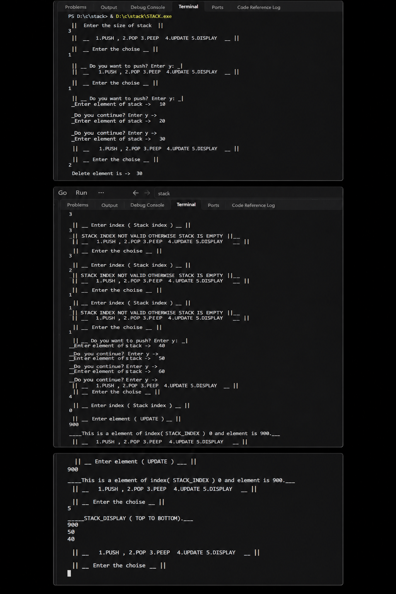

# Singly Linked List in C

This program creates a singly linked list and provides menu-driven operations from **1 to 10**, with **11** to exit. You can create a linked list and modify it by adding nodes at the starting position, ending position, or at a specific position (before or after a given node).

> **Important Note:** Make sure to perform **Operation 1** (create the linked list) first—if the linked list is not created yet, the operations will not work as expected.

## Output Screenshots

## Stack in C

This program implements an array-based **Stack** in C with a menu-driven interface supporting **5 operations**: **Push**, **Pop**, **Peep**, **Update**, and **Display**.

### Indexing & Top Pointer
* Stack indexing starts at **0**.
* The `top` pointer points to the top of the stack.
* If the stack has a size of **3**, the `top` pointer is at **3**.
* When performing a **Peep** operation for a given index (for example, index **2**), it accesses the element from top to bottom at index **2**.

### Operations
1. **Push**: Inserts a new element onto the top of the stack (with overflow check).
2. **Pop**: Removes and displays the top element from the stack (with empty/underflow check).
3. **Peep**: Views an element from top to bottom at the specified index without removing it.
4. **Update**: Overwrites an existing element in the stack with a new value.
5. **Display**: Prints the current elements stored in the stack.

### Output Screenshot

